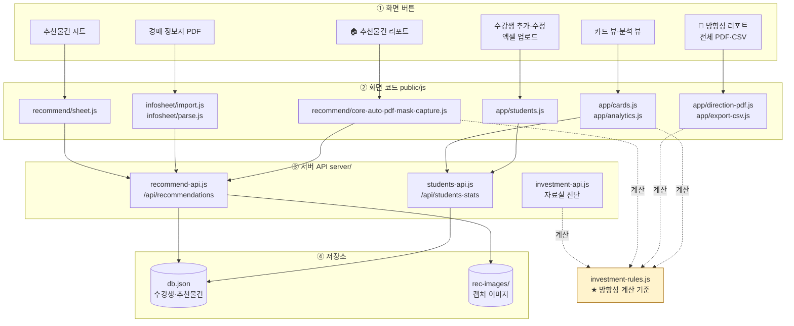
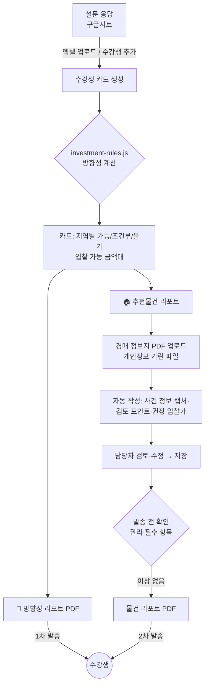
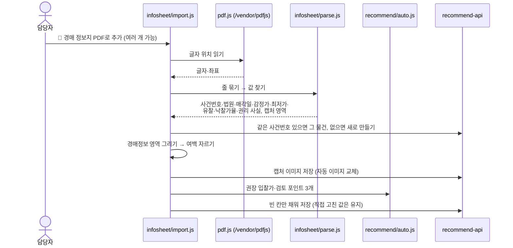
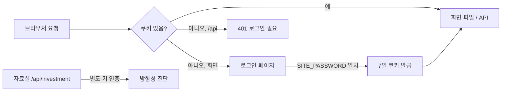
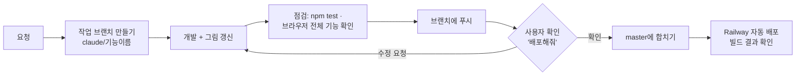

# 코드 구조와 업무 흐름

수강생 경매 투자 방향성 컨설팅 사이트의 **어디에 무슨 코드가 있는지**와 **업무가 어떤 순서로 흐르는지**를 그림으로 정리한 문서입니다.
GitHub에서 이 파일을 열면 아래 그림(Mermaid)이 바로 그려집니다. 기능을 고치면 이 문서의 그림도 같이 고칩니다.

---

## 1. 폴더 구조 (코드 위치)

```
server.js                    서버 시작점 (설정과 연결만)
server/
  auth.js                    로그인·로그아웃, 로그인 확인
  login-page.html            로그인 화면
  db.js                      db.json 읽기·쓰기 (Railway Volume)
  students-api.js            수강생 API: 목록·추가·수정·삭제·통계·엑셀 일괄 등록
  recommend-api.js           추천물건 리포트 API: 물건·이미지 저장, 시트 초안
  investment-api.js          평생회원 자료실용 방향성 진단 API (키 인증)

public/
  index.html                 화면 틀 (HTML만)
  css/app.css                화면 디자인
  js/investment-rules.js     ★ 투자 방향성 계산 기준 (화면·CSV·PDF·자료실 공통, 유일한 기준)
  js/app/                    메인 화면 (수강생 카드)
    core.js                    공통 상태·서버 호출·목록 불러오기
    students.js                수강생 추가·수정·삭제, 엑셀 일괄 등록
    cards.js                   카드 뷰 (요약칸·수강생 카드)
    analytics.js               분석 뷰
    direction-pdf.js           [📄 방향성 리포트] PDF, 전체 PDF(ZIP)
    export-csv.js              CSV 내보내기
    main.js                    화면 전환·자동 새로고침·시작
  js/recommend/              [🏠 추천물건 리포트]
    core.js                    입력 창·저장·목록 (다른 파일과 RecCore로 연결)
    auto.js                    검토 포인트·권장 입찰가 자동 작성, 발송 전 확인
    pdf.js                     물건 리포트 PDF
    mask.js                    캡처 이미지 자르기·모자이크
    capture.js                 크롬 캡처 도우미 연동 (탱크옥션 자동 캡처)
    sheet.js                   구글시트 요약 탭 → 추천물건 초안
  js/infosheet/              경매 정보지 PDF
    parse.js                   정보지 글자 → 사건번호·금액·권리 등 값 (테스트와 공용)
    import.js                  PDF 읽기(pdf.js)·캡처·칸 채우기

test/                        자동 테스트 (npm test)
tank-capture-extension/      크롬 확장프로그램 '추천물건 캡처 도우미'
```

## 2. 코드 연결 그림 (시각화)

위에서 아래로: **화면 버튼 → 화면 코드 → 서버 API → 저장소**. 노란 상자 `investment-rules.js`는 방향성 계산 기준으로, 화면과 서버가 같은 파일을 씁니다.



- 모든 `/api` 요청은 `server/auth.js`의 로그인 확인을 먼저 거칩니다(자료실 진단 API만 별도 키).
- 크롬 확장프로그램 '추천물건 캡처 도우미'는 `recommend/capture.js`와 메시지로 주고받습니다.

## 3. 업무 흐름 (프로세스)

### 3-1. 수강생 1명 컨설팅 전체 흐름



### 3-2. 경매 정보지 PDF → 물건 리포트 자동 작성



### 3-3. 로그인과 요청 처리



## 4. 개발·배포 흐름 (브랜치)



- 기능 하나 = 브랜치 하나 (예: `claude/split-by-feature`, `claude/docs-diagrams`)
- master에는 사용자가 확인한 뒤에만 합칩니다. master에 합치면 Railway가 자동으로 배포합니다.
- 코드 줄 정리: `npm run format` (Prettier, 한 줄 120자 기준, 설정 `.prettierrc.json`)
